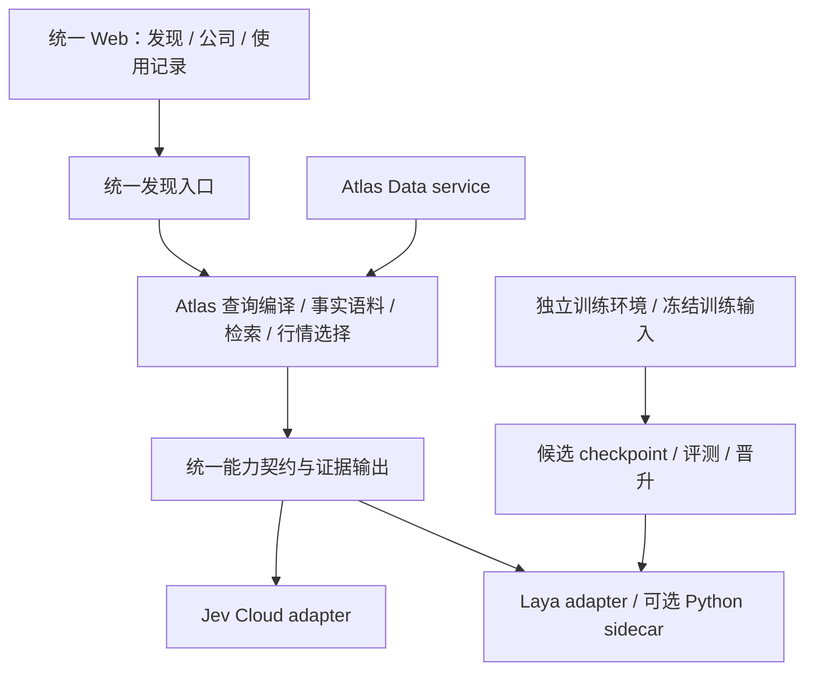

# Atlas 与 a-share-trawler 合并可行性评估

日期：2026-10-12。范围：统一前端与工程框架、显式切换 Jev/Laya、保留 Laya 继续训练能力。

评估依据是本机代码与既有实验记录：Atlas HEAD `bf44fe8`，trawler HEAD `06b939a`，并包含当前未提交改动。没有运行模型、训练、LIVE benchmark 或重启服务；本文中的历史性能不是本轮实测。本文是提案，不改变现行产品与运行契约。

## 结论

技术上可行。推荐以 Atlas 为唯一产品应用，合入需要的 trawler 前端差异与 Laya 服务/训练链；统一公司事实、查询编译、检索、结果和证据契约，在 capability 内选择判断 provider。训练保留独立 Python 环境和候选产物生命周期。

收益主要是减少两套前端、数据和搜索代码的长期维护，以及让同一真实查询可以切换判断来源。难点不在 Next.js，也不在调用地址，而在 Laya 对 Atlas 能力契约的适配与质量验收。

可以先交付显式切换与继续训练；目前证据不足以承诺 Laya 能等价覆盖 Atlas 的全部语义能力。完整覆盖需要关系判断、证据支持判断及严格行情资格的专项验收，必要时补训练。

## 当前事实

| 维度 | Atlas | a-share-trawler | 合并影响 |
| --- | --- | --- | --- |
| Web 框架 | Next 16.3.8 / React 19.2.8 / TS / Tailwind 4 | Next 16.3.5 / React 19.2.8 / TS / Tailwind 4 | 技术栈已一致，统一版本即可，无需换框架 |
| 物理前端 | Matter.js，LOGO/文字卡，证据与行情提示 | Matter.js，LOGO/文字卡，新公司页日线 | 保留 Atlas 交互，按差异迁入组件 |
| 产品范围 | 公司发现 + `/stock/:symbol`，内部 `/usage` | 发现 + `/company/:code`；规划行情研究工作台 | 统一 URL；自选、笔记、手动持仓尚非此次目标 |
| 查询与召回 | 确定性市场 grammar + 原样 semantic residual；Company Corpus | QuerySpec + 行业/概念 ontology 扩展、派生能力标签、排除规则 | 存在语义架构冲突，生产使用 Atlas 管线 |
| 判断 | Jev Cloud 单 provider，能力契约携带 evidenceRefs | 有 key 选 Jev；无 key 配 Laya；Laya V3 路径优先四档 score | 当前不是自由切换，需要显式 provider 选择 |
| 事实输入 | `data/company-corpus/`，原文、披露时点和出处 | `search_profiles_v3`，含知识派生文本 | Laya 迁入后输入分布改变，历史成绩不能直接沿用 |
| 运行时 | Web `3400` + Data `8920` | Web `7488` + Laya `8787`（登记契约） | 统一 Web，Data 保留，Laya 可选启动，训练为独立任务 |
| Laya | 历史脚本，不是运行时能力 | V4.1 在用契约；V4.2-B 候选；模型与训练输入在本机存在 | 服务与训练机制可复用，候选不自动晋升 |
| 发布 | 公开代码，私有数据与报告不入历史 | `git ls-files data reports models` 有 465 条路径 | 选择性迁入代码，不合并旧 refs/history |

对文件进行换行归一后，两个项目的 `SearchComposer`、`SettingsPanel`、`floor/bounds`、`floor/forces`、`floor/layout`、`floor/theme` 完全相同；`laya_server.py`、`train_laya_v4_2.py`、`build_train_pairs_v4_2.py` 也完全相同。Atlas 已经保留大量共同基础，直接整体复制会制造重复。

当前工作区也必须计入迁移：Atlas 有盘中时效修复及验收文档；trawler 有未提交公司页、日线接口、图表和点击行为。只比较 HEAD 会遗漏这些工作。

## 推荐边界

统一产品与仓库，并不要求把训练进程塞进 Next.js。第一轮保留 Atlas 的现有根目录结构，减少 `process.cwd()` 与脚本 `ROOT = parents[1]` 路径迁移；Python Data 与 Laya/训练分别管理依赖。后续只有出现实际复用需求时再抽 package 或 workspace。

前端消费统一结果与 EvidenceView，不直接接触模型 wire。公司 canonical URL 保留 `/stock/:symbol`，旧 `/company/:code` 可重定向。若迁入日线，复用 trawler 的图表展示，经 Data adapter 提供数据，补齐缺失、覆盖与故障的分类；当前 bars 接口把全部读取失败归为 SOURCE_GAP，不能原样成为 Atlas 的数据契约。Vela 使用范围及署名要求沿用 trawler 现行约束。

## Jev / Laya 自由切换

“自由切换”应是用户明确选 Jev 或 Laya，即使同时有 key 和 Laya 地址也能选；切换在下一次搜索生效，在途请求固定使用开始时的选择。故障时如实降级或提示能力未就绪；跨模型切换由用户明确触发。

现有 `JudgeProvider.id` 和 `ProviderStatus.provider` 只允许 `jev`，capability 直接取 `jevProvider()`，预算、计费与健康状态也依赖云端假设。现有 override 是测试 seam，不能直接当作产品切换开关。建议保留能力语义与证据契约，抽取请求级 provider context，并将其传到 match / relation / comparison / explanation / market eligibility。

必须同时处理：

- **请求身份**：provider、实际模型/权重摘要、prompt/adapter 版本、能力契约版本、corpus digest；配置别名不能代替实际身份。Laya 复用 `/health` 的 checkpoint SHA，Jev 保留应答身份核验。
- **缓存**：发现答案、行情资格、解释缓存及前端结果状态均隔离 provider 与实际身份。旧结果点开解释时绑定原判断来源，不用当前选择重新解释。避免全局 mutable provider 引发并发混用。
- **分数**：Jev match 是 noul，trawler Laya 默认四档 grade/3；区间相同不意味着阈值或资格等价。先验证相同 noul 契约；若采用 graded 策略，则独立版本化和校准，不能直接混用旧阈值。
- **能力清单**：区分可以发请求、通过格式契约、通过目标场景验收三个层级。未验收能力不能因 wire 支持 noul/score 就标可用。
- **失败与预算**：保留 unknown/degraded、部分批次失败和扫描不完整；按 provider 管理超时与并发。Laya 的 GPU 时间/排队预算与 Jev 的云端估算费用分开记录，不把本地 token 数乘云价，也不把本地推理表述为零运行成本。
- **使用记录**：每条 trace 落请求选择与实际回答身份；缓存命中仍可审查；observer 不新增判断请求。

| Atlas 能力 | Laya 现有依据 | 合并裁定 |
| --- | --- | --- |
| semantic_match | 训练含 noul；生产更依赖四档重排 | 可做首轮接入，须在 Atlas corpus 上验证 |
| semantic_comparison | 已有四档训练、评测与 wire | 接口接近，仍需同输入契约验收 |
| semantic_relation | 未找到 Atlas relation 契约的专项验收 | 不能承诺等价，尤其是关系强度/方向/披露时点 |
| evidence_explanation | 能发 noul，不等于能选出支持判断的证据 | 需要逐证据支持验收，输出继续只引用所给原文 |
| market-eligibility | 建立在 match/relation 与 known 上 | 跟随已验收能力，保留完整扫描与不补位规则 |

trawler 的 ontology、语义扩展和规则 grader 可继续用于历史训练回放，放在训练实验边界内，不进入统一生产 parser/ranking/corpus。否则改动会同时改变事实、召回和模型，既违背 Atlas 边界，也无法解释质量差异来自哪里。

## 继续训练 Laya

本机存在 V4.1、V4.2-B 权重以及 V4.2-B 训练 pairs/items/val 输入。`train_laya_v4_2.py` 已支持 `--init` 从既有权重继续微调、`--out` 输出候选，强制 CUDA；因此合并不需要重写训练算法。此处仅核查文件与代码，未验证当前依赖环境可实际完成训练。

需要保留两种不同用途：历史 profile/ontology 输入用于旧实验可复现；后续面向 Atlas 的训练使用冻结 corpus 快照与对应 prompt/契约。真实失败 trace 可进入待标注队列，但搜索输出不能自动成为真值；标注、隔离、构建 manifest、训练与独立验收仍各自可追溯。Atlas 的冻结质量集只用于验收，不进入训练样本或生产规则。

训练产物写入新的候选目录，运行中的权重与数据不被覆盖；checkpoint hash 固定，评测通过后显式晋升，再加载新版本并使缓存失效。V4.2-B 的既有结论是 PASS WITH FOLLOW-UP，真实使用证据不足，不能因合并就改成默认。

训练与推理可以保留在同一工程，但单卡同时执行不宜作为默认保证。历史性能报告记录单张 8GB GPU 常驻 sidecar 显著压缩训练可用显存并减速，训练窗口暂停 sidecar 后恢复。建议提供明确的“使用 Jev 并训练 Laya”操作；用户保持 Laya 时，应明确训练期间不可用或安排顺序执行。并行稳定服务若成为硬需求，再考虑单独 GPU 或远端训练。

当前训练脚本的继续训练是加载权重后新建 optimizer/scheduler，并非精确恢复中断任务；若需要断点续训，另补 optimizer、scheduler、随机状态和训练进度保存。不要把两者混称。

## 质量依据与局限

trawler 已有同资料、同 score 题型的 20 题 × 6 公司盲测：Laya V4.1 四档正确率 82.5%，Jev 1.13.0 四档 90.0%；Jev noul 95.8% 是不同题型结果，不能与四档直接等价比较。这是小型人工候选判断测试，没有衡量全市场召回，不能推导 Atlas 全链路差距。

V4.2 历史报告记录 GPU rerank200 p50 约 0.262 秒、峰值显存 1.66GB，并指出训练并行资源冲突。这些数字来自旧输入、旧评测环境，不能作为合并后的性能承诺。

合并验收应固定相同 corpus、查询、候选/市场集合、提示与能力版本，仅改变 provider；分别检查格式契约、证据约束、完整扫描、真实反馈与延迟。首次建立 Laya/Atlas 基线后，再判断需要多少训练。工程测试和质量基线分开；训练与 shadow 请求明确标实验，不污染真实使用统计。LIVE 调用预算预先限定，阶段性才扩大范围。

Atlas M2 盘中时效与源端量比仍有条件未验收，见 2026-10-08 实测。合并不使这些条件自动通过。

## 实施顺序与估算

1. **固定合并基线**：保存两个工作区未提交成果与私有数据清单，明确统一应用范围及新的双 provider 契约；Atlas 为主线，trawler 保留可回放快照。此阶段不导入旧 Git 历史。
2. **最小兼容验证**：共用 Atlas corpus、请求 payload 与固定候选，验证 Laya match/comparison；核对身份、有效分数、失败和证据输出。结果决定能力开放范围。
3. **接入统一应用**：显式模型选择、请求级上下文、缓存、健康、trace 与可选 sidecar 启停；保留 Jev 路径行为。统一公司页与所需前端差异。
4. **迁入训练链**：保留 Python 独立环境、私有 artifact 路径和历史回放，新增 corpus 训练输入机制、候选登记与晋升。完成一次受控训练/加载验证。
5. **验收与收束**：离线契约/故障/并发隔离、物理交互与公司页检查、定量受限的双 provider 质量验证、publication 检查；稳定后停止维护第二套产品前端。

在不改产品范围、不重写训练算法的前提下，基本工程整合粗估 **1–2 周**；这是规划估算，不是承诺。Laya 全部 capability 达到 Atlas 质量要求所需的标注与训练轮次，现有证据不足以估计。只加模型开关会更快，但达不到这里定义的统一事实、证据和训练生命周期。

合并需要修订 Atlas 的 Jev-only、两个受管服务、Laya 归属规则及相应 README/健康/身份测试，Harbor 登记改为一个应用、按模式启停可选 Laya。用户本次明确需求构成该方案的需求依据；本评估不执行修改，也不解除其他产品能力冻结。

公开仓继续仅发布代码。trawler 的训练数据、报告、来源摘录及权重作为私有 artifact 管理，迁入服务/训练代码时复核依赖许可和署名。现有 publication 检查会检查全部可达历史；直接 merge trawler refs 会带入私有路径。权重文件的专门排除/审计也须补齐，不能只依赖当前检查脚本的后缀列表。

## 主要出处

- Atlas：`AGENTS.md`、`package.json`、`lib/jev/provider.ts`、`lib/jev/cloud.ts`、`lib/jev/capabilities/`、`lib/atlas/discoverCache.ts`、`lib/atlas/runtime.ts`。
- Atlas：`docs/JEV_FIRST_ARCHITECTURE.md`、`docs/JEV_CAPABILITY_LAYER.md`、`docs/PRODUCT_USAGE_BASELINE.md`、`docs/PUBLIC_CODE_RELEASE.md`、`docs/MARKET_INTRADAY_ACCEPTANCE_2026_10_08.md`、`tests/architecture_boundary.test.ts`。
- trawler：`AGENTS.md`、`package.json`、`lib/jev/client.ts`、`lib/jev/judge.ts`、`lib/search/pipeline.ts`、`lib/search/querySpec.ts`、`lib/telemetry/contract.ts`。
- trawler：`scripts/laya_server.py`、`scripts/laya_version.py`、`scripts/train_laya_v4_2.py`、`scripts/build_train_pairs_v4_2.py`、`scripts/build_laya_items_v4_2.py`。
- trawler：`reports/LAYA_V4_2_FINAL_REPORT.md`、`reports/LAYA_V4_2_PERFORMANCE.md`、`reports/model_contest/unseen_v1/REPORT.md`、未提交 `app/company/[code]/page.tsx` 与 `app/api/bars/[code]/route.ts`。
- `docs/A_ATLAS_TARGET_ARCHITECTURE.md` 仍含退役 Research `8910` 与 Vibe 阶段内容，不作为当前运行时事实来源。
